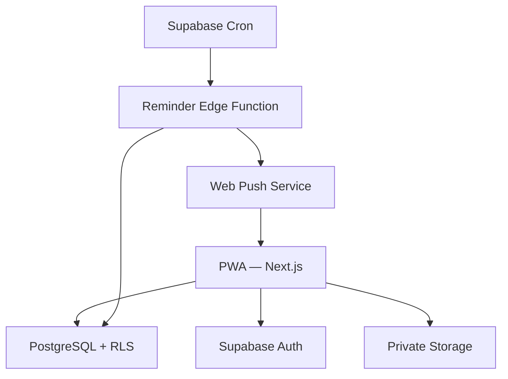
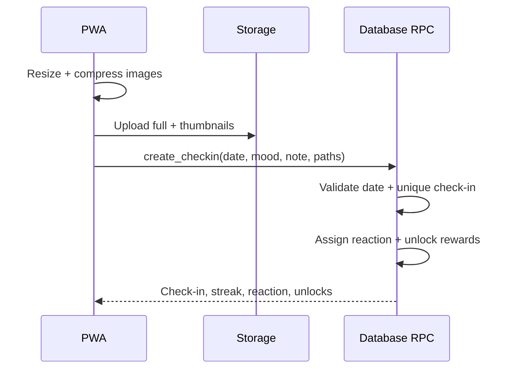

# Akiha — Technical Architecture

## 1. Kiến trúc mục tiêu

Hai platform chính: Vercel và Supabase. Edge Function chỉ dùng cho scheduled reminder vì đây là logic nền cần chạy khi PWA không mở.

## 2. Frontend

- Next.js App Router, TypeScript strict.
- Server Components mặc định cho read-heavy page.
- Client Components chỉ dùng cho interaction, animation, camera/image processing và push subscription.
- Tailwind cho styling; CSS variables chứa design tokens.
- Motion for React cho animation.
- Zod validate form input và payload tại boundary.
- Không cần Redux. Server state fetch theo Next.js/Supabase; local form state dùng React.

## 3. Auth và session

- Supabase Auth là identity provider duy nhất.
- `profiles.id` tham chiếu `auth.users.id`; role chỉ là `user|admin` và do migration/admin seed tạo.
- Middleware chỉ dùng cho redirect nhanh; authorization thật phải kiểm tra tại server/RPC và RLS.
- Không bundle service-role key vào client.
- Public client chỉ nhận URL và anon/publishable key.

## 4. Data access pattern

### Read

- Server page gọi view/RPC tối ưu cho Home, Calendar và Rewards.
- Tránh N+1 signed URLs. Có thể trả object path rồi batch-generate signed URLs server-side với TTL ngắn.
- Cache private user data ở mức request hoặc `no-store`; không dùng public CDN cache cho response cá nhân.

### Write

- Simple profile/moment edit có thể dùng validated server action.
- Check-in, reaction assignment và reward unlock phải chạy trong một transaction/RPC để idempotent.
- Admin correction/protected day phải qua RPC có role check và audit log.

## 5. Check-in transaction

Luồng đề xuất:

Nếu database mutation thất bại sau upload, client gọi cleanup endpoint/RPC cho object vừa upload hoặc scheduled cleanup xóa orphan object sau 24 giờ. Object path phải chứa UUID ngẫu nhiên, không tin filename từ user.

## 6. Image pipeline

### Client preprocessing

- Chấp nhận JPEG, PNG, WebP và các định dạng browser decode được.
- Validate MIME thực tế và file size; không chỉ dựa extension.
- Auto-orient theo browser decode.
- Full image: cạnh dài tối đa 1280 px, WebP quality khoảng 0.78–0.82.
- Thumbnail: 256 px, WebP quality khoảng 0.70–0.76.
- Strip metadata bằng re-encode qua canvas.
- Max 3 ảnh/check-in; sau compress mỗi full image mục tiêu dưới 500 KB.
- Nếu browser không encode WebP ổn định, fallback JPEG.

### Storage

- Bucket private `moments`.
- Path: `{owner_user_id}/{local_date}/{asset_uuid}/full.webp` và `thumb.webp`.
- Không dùng public URL.
- Xóa database row và storage object theo quy trình có retry/audit.

## 7. PWA

- Có `manifest.webmanifest`, icons 192/512, maskable icon, theme/background color.
- Service worker cache app shell và asset versioned.
- Không cache response auth/private data bằng cache-first.
- Offline: cho xem shell và dữ liệu gần nhất nếu đã cache an toàn; check-in mới giữ draft local nhưng chỉ confirm sau server success.
- Update banner nhẹ khi service worker mới sẵn sàng.

## 8. Reminder/Web Push

### Scheduler

- Dùng Supabase `pg_cron` gọi một Supabase Edge Function theo lịch ngắn, ví dụ mỗi 15 phút.
- Function đọc `app_settings.reminder_time` và timezone, chỉ xử lý cửa sổ hiện tại.
- Dùng database idempotency key `(recipient_id, local_date, kind)` trước khi gửi.
- Secret cho scheduler/push lưu trong Supabase secrets/Vault, không commit.

### Push

- Browser tạo Web Push subscription sau user gesture và lưu endpoint + keys trong `push_subscriptions`.
- Edge Function gửi payload tối thiểu, không chứa nội dung riêng tư nhạy cảm trên lock screen.
- Subscription trả `404/410` phải được deactivate.
- Nếu không hỗ trợ hoặc user từ chối: Home hiển thị reminder in-app, không spam prompt permission.

### Lưu ý nền tảng

- PWA notification phụ thuộc browser/platform và permission của user.
- Vercel Hobby cron chỉ phù hợp job hằng ngày, timezone cron là UTC và thời điểm có thể không chính xác tuyệt đối; vì reminder time có thể cấu hình, scheduler đặt ở Supabase hợp lý hơn.
- Tài liệu tham khảo chính thức: [Vercel Cron usage](https://vercel.com/docs/cron-jobs/usage-and-pricing), [Supabase scheduled functions](https://supabase.com/docs/guides/functions/schedule-functions), [PWA capabilities](https://web.dev/learn/pwa/capabilities).

## 9. API/RPC surface tối thiểu

Tên có thể thay đổi nhưng semantics phải giữ:

- `get_home_state(local_date)`
- `create_checkin(local_date, mood, note, assets[])`
- `update_moment(checkin_id, mood, note)`
- `get_calendar_month(year, month)`
- `get_reward_state()`
- `propose_reward(input)`
- `admin_review_reward(reward_id, decision, edits)`
- `admin_correct_checkin(input)`
- `admin_set_protected_day(local_date, reason)`
- `admin_send_encouragement(input)`
- `register_push_subscription(input)`

RPC phải derive actor từ `auth.uid()`, không nhận `actor_id` từ client.

## 10. Environment variables

`.env.example` chỉ chứa tên và placeholder:

- `NEXT_PUBLIC_SUPABASE_URL`
- `NEXT_PUBLIC_SUPABASE_PUBLISHABLE_KEY`
- `SUPABASE_SERVICE_ROLE_KEY` — server-only, chỉ nếu thật sự cần
- `NEXT_PUBLIC_VAPID_PUBLIC_KEY`
- `VAPID_PRIVATE_KEY` — Edge Function secret, không đưa vào Vercel client env
- `VAPID_SUBJECT`
- `APP_TIMEZONE=Asia/Ho_Chi_Minh`

Không dùng `NEXT_PUBLIC_` cho private secret.

## 11. Observability tối thiểu

- Structured server logs: event name, request/correlation id, actor id hash hoặc UUID, status, duration.
- Không log JWT, push endpoint đầy đủ, secret reward content hoặc signed URL.
- `notification_deliveries` ghi trạng thái sent/skipped/failed và error code đã sanitize.
- Có admin-only health/debug page rất nhỏ hoặc documented SQL queries; không cần external APM cho V1.

## 12. Performance budgets

- Home LCP mục tiêu < 2.5 s trên mobile 4G sau cold load.
- Calendar không tải full images.
- Initial JS tránh vượt khoảng 200 KB gzip nếu không cần thiết.
- Check-in UI phản hồi tap ngay; progress thật cho compress/upload.
- Dùng responsive image sizing và lazy load ngoài viewport.
- Tránh server action gọi tuần tự khi có thể gom thành một RPC.

## 13. Backup và portability

- Migrations và seed nằm trong git, có thể dựng lại schema.
- Hướng dẫn export database/storage thủ công trước thay đổi lớn.
- Không phụ thuộc storage URL hard-coded; lưu object path để sau này chuyển R2 nếu cần.

